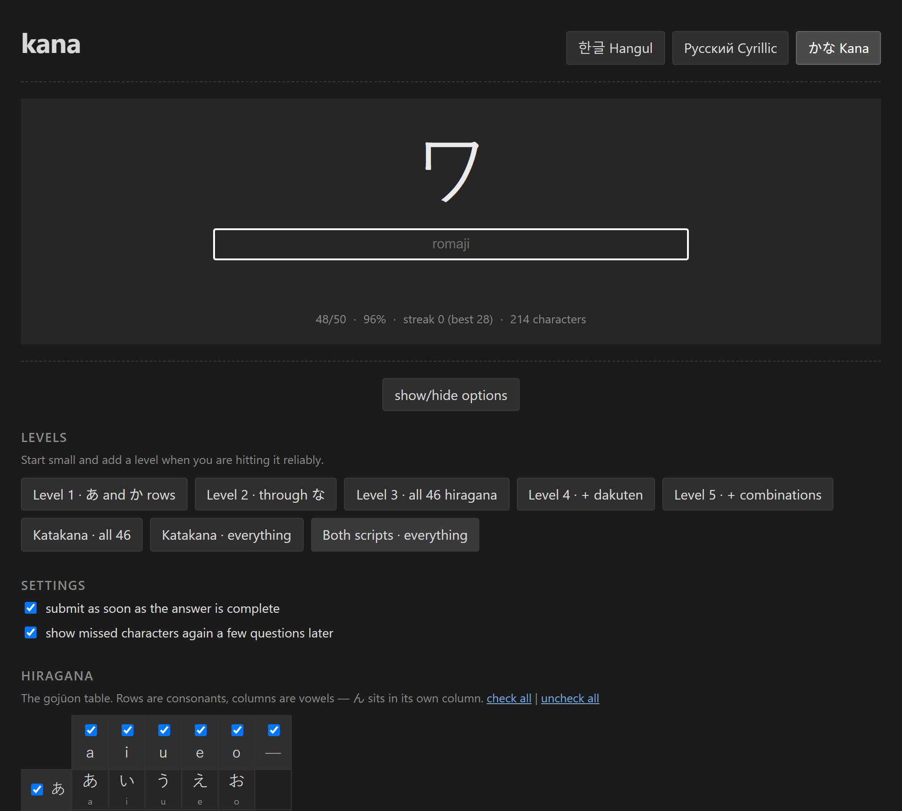

# Hangul, Cyrillic & Kana recognition trainer

A character-recognition drill in the mould of the [itazuraneko kana trainer](https://itazuraneko.neocities.org/learn/kana.html):

Three alphabets, switched with the tabs at the top right: **Hangul** (한글), **Russian Cyrillic**, and
**Kana** (かな)

## Running it

Open `index.html` with any browser. You might serve it if you have somewhere.

Progress, selection and settings are kept in `localStorage` so anything that might block or impede that will affect stats.
